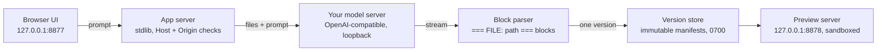

# kodros-localbolt

A prompt-to-web-app builder that runs on your own machine. Describe a small web app, watch the files appear, edit them, restore any earlier version and download a zip. The model is one you serve yourself, so prompts and generated code never leave the network.

## Hardware and on-prem

- Linux and Python 3. The app is standard library only: no npm, no CDN, no pip packages. It needs no GPU itself.
- The VRAM comes from the model server you point it at. Any OpenAI-compatible endpoint works (llama.cpp server, vLLM, Ollama and similar). A Llama, Gemma, gpt-oss or Granite model fits the same way. The author's runs used a DeepSeek model (non-US origin) at about 60 seconds for a small polished app with thinking off. How much memory your model needs depends on the model and quantization you choose.
- Both servers bind `127.0.0.1` and answer 403 to any other Host header. The only endpoint it ever contacts is the model URL you set (default `http://127.0.0.1:8080/v1`). If the model is down, projects, editor, versions, preview and zip still work, and nothing is sent to a cloud model.

## How it works



The model answers in a plain block format, and a streaming parser turns each finished block into a file write. All writes from one prompt commit as one version. A failed or cut-off answer commits nothing. Every change is a new immutable version, so restore creates a new version instead of rewriting history.

The preview runs on a second origin inside a sandboxed iframe with a strict Content-Security-Policy. A generated app cannot read the editor, reach the network or call the LocalBolt API. File paths are validated (relative, at most 8 segments, extension allow-list, 512 KiB per file, 200 files, 8 MiB per project).

## Stack

Python 3 standard library, plain HTML, CSS and JS for the UI. Data lives in `~/.local/share/localbolt/` (mode 0700, override with `LOCALBOLT_HOME`).

## Build and run

```bash
git clone https://github.com/thefiredev-cloud/kodros-localbolt.git
cd kodros-localbolt
python3 -W error::ResourceWarning -m unittest discover -s tests -t .    # 79 tests, no model needed
export LOCALBOLT_LLM_URL=http://127.0.0.1:8080/v1
export LOCALBOLT_LLM_MODEL=<an id listed by GET /models on your server>
bin/localbolt serve                  # UI 8877, preview 8878
bin/localbolt generate "a pomodoro timer" --name Pomodoro
```

[BUILD.md](BUILD.md) lists every command, setting and the security model.

## Limits

- Static HTML, CSS and JS only. No npm packages, backend code, terminal, deploy button or GitHub sync.
- The editor is a plain textarea with no syntax highlighting. Preview refreshes after each version, with no hot reload.
- The model id you set must appear in the server's `/models` list, or the UI shows "Model unavailable".

## License

Copyright 2026 Tanner Osterkamp. All rights reserved. See [LICENSE](LICENSE). The source is public to read; ask before reuse.
